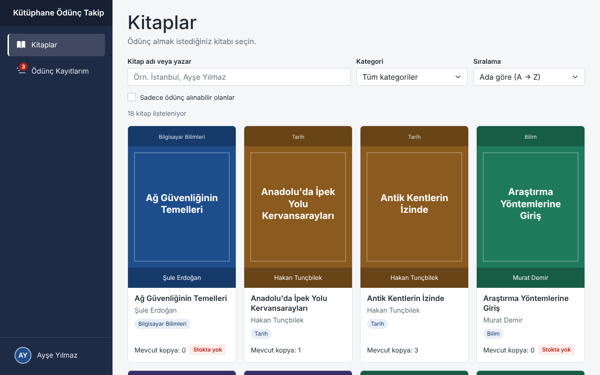
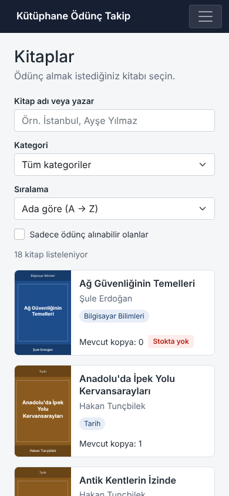
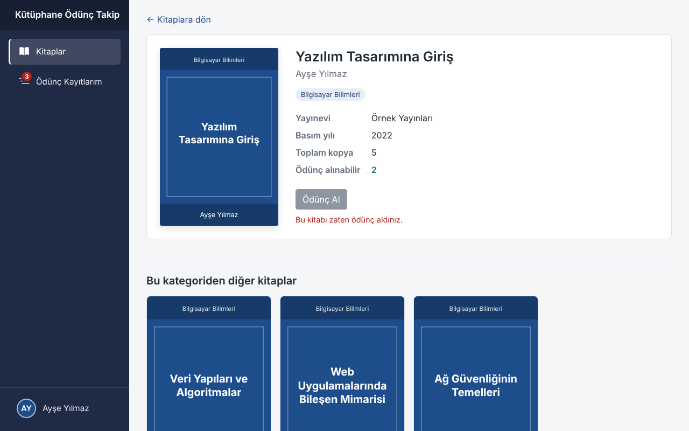
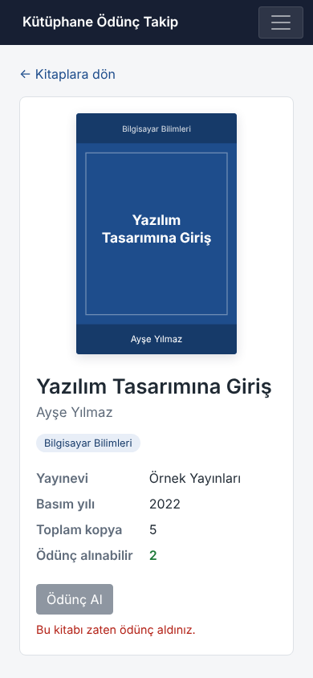
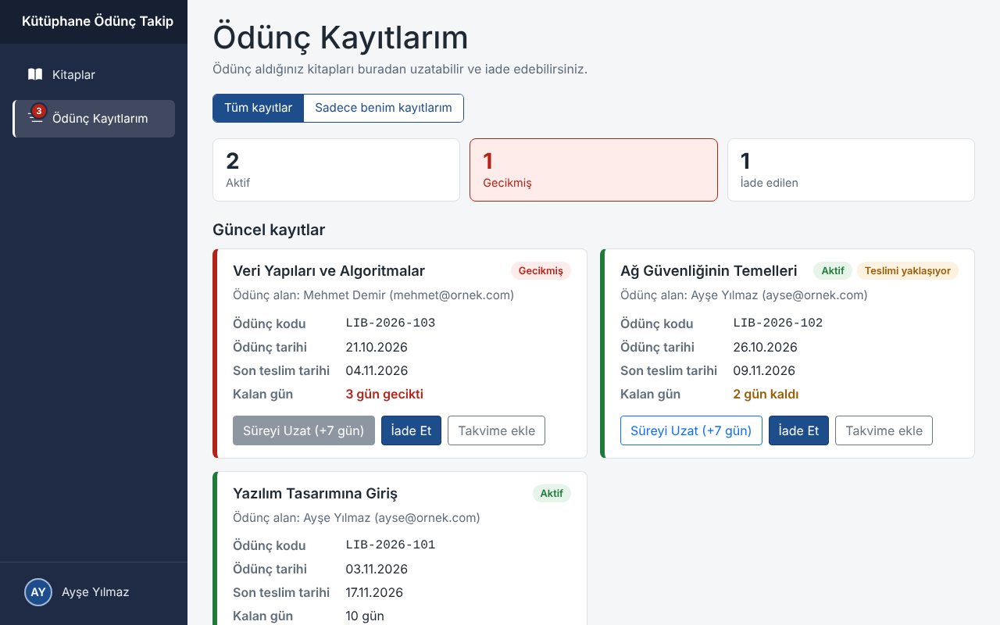
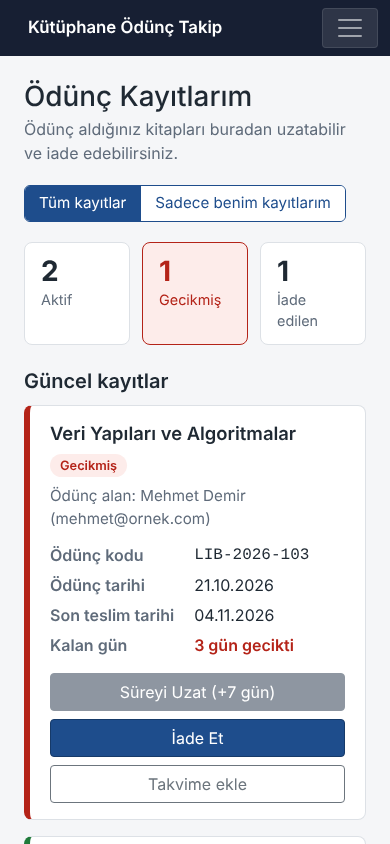

# Kütüphane Ödünç Takip

İleri Web Programlama dersi vize ödevi. Blazor WebAssembly (.NET 8) ile yazılmış bir kütüphane uygulaması. Kullanıcı:
- Kitapları listeleyip arayabiliyor.
- Kitap ödünç alabiliyor.
- Teslim süresini takip edip uzatabiliyor.
- Kitabı iade edebiliyor.

- **Canlı uygulama:** https://eminekibar.github.io/kutuphane-odunc-takip/
- **Wiki:** https://github.com/eminekibar/kutuphane-odunc-takip/wiki. Her issue için bir sayfa var: ne yapıldı, neden öyle yapıldı, nasıl test edildi.

## Ekran görüntüleri

| | Masaüstü | Telefon |
|---|---|---|
| Kitaplar |  |  |
| Kitap detayı |  |  |
| Ödünç kayıtlarım |  |  |

Görüntüler `tools/ekran-goruntuleri.ps1` ile canlı uygulamadan alındı. Ödünç kayıtları sayfasında örnek veri var: bir aktif, bir teslimi yaklaşan, bir gecikmiş ve bir iade edilmiş kayıt.

## Çalıştırma

Gereken: [.NET 8 SDK](https://dotnet.microsoft.com/download/dotnet/8.0).

```powershell
dotnet run --project KutuphaneOdunc
```

Komutun yazdığı adresi (`http://localhost:...`) tarayıcıda açın. Visual Studio'da `KutuphaneOdunc.sln` açılıp **Ctrl+F5** ile de çalışır.

Repodaki `global.json` .NET 8'i seçiyor. Bilgisayarda daha yeni bir SDK kurulu olsa da proje .NET 8 ile derleniyor.

## Ödevde istenenler

| Konu | Uygulamada |
|---|---|
| Kitap verisi | 18 kitap, 5 kategori. `wwwroot/data/books.json`'dan `BookService` ile asenkron okunuyor. |
| Kitap listesi (`/books`) | Kartta kapak, ad, yazar, kategori, mevcut kopya. Kopya 0 ise "Stokta yok" etiketi. |
| Arama ve filtre | Kitap adı veya yazara göre arama, kategori filtresi. Arama Türkçe büyük/küçük harfe duyarsız: "istanbul" araması "İstanbul"u buluyor. |
| Kitap detayı (`/books/{id}`) | Yayınevi, basım yılı, toplam ve ödünç alınabilir kopya. Olmayan kitapta "Kitap bulunamadı". |
| Uygunluk | Kopya 0 ise ya da bu tarayıcıda o kitabın iade edilmemiş kaydı varsa "Ödünç Al" pasif ve sebebi yazıyor. |
| Ödünç alma formu | `EditForm`, `DataAnnotationsValidator`, `ValidationMessage`. Ad soyad zorunlu, 3–60 karakter. E-posta zorunlu ve geçerli biçimde. |
| Ödünç kaydı | Kod `LIB-<yıl>-<sıra>` (en büyük sıra + 1, ilk kod 101). Ödünç tarihi bugün, son teslim bugün + 14 gün. Mevcut kopya bir azalıyor, 0'ın altına inmiyor. |
| Ödünç kayıtları (`/my-loans`) | Kitap adı, kod, ödünç tarihi, son teslim tarihi, kalan gün. "Aktif" (yeşil), "Gecikmiş" (kırmızı), "İade edildi" (gri) etiketleri. Güncel kayıtlar ve Geçmiş ayrı bölümlerde. |
| Süre uzatma | Süresi geçmemiş, iade edilmemiş ve daha önce uzatılmamış kayıt bir kez 7 gün uzatılabiliyor. |
| İade | Kayıt iade edildi oluyor, mevcut kopya bir artıyor, toplam kopyayı aşmıyor. İade edilmiş kayıtta uzatma ve iade yapılamıyor. |
| Kalıcılık | Kayıtlar, kopya sayıları ve profil localStorage'da. Sayfa yenilense de yeni sekmede açılsa da aynı durum görünüyor. Bozuk veride uygulama çökmüyor. |

## Eklediğimiz özellikler

Ödevin kurallarını değiştirmeden eklendi:

| Özellik | Issue |
|---|---|
| Profil sayfası (`/profile`): bu tarayıcıya ait ad ve e-posta, sayfa içinde onay sorulan silme | #39 |
| Menüde profil alanı: baş harflerden avatar ve ad | #40 |
| Ödünç formu profil varsa dolu açılıyor | #41 |
| Kayıtta "Ödünç alan: Ad Soyad (e-posta)", profil varsa "Sadece benim kayıtlarım" filtresi | #42 |
| İşlemlerden sonra köşede 4 saniyelik bildirim (toast) | #43 |
| Teslime 3 gün ya da daha az kalan kayıtta turuncu "Teslimi yaklaşıyor" etiketi | #44 |
| Menüde iade edilmemiş kayıt sayısını gösteren rozet. Gecikme varsa kırmızı. | #45 |
| `/my-loans` üstünde Aktif / Gecikmiş / İade edilen sayıları | #46 |
| Teslim tarihi için takvim dosyası (`.ics`) | #47 |
| Kitap detayında aynı kategoriden en fazla 4 kitap | #48 |
| Ada, yazara, basım yılına, mevcut kopyaya göre iki yönlü sıralama (Türk alfabesi sırasıyla); "Sadece ödünç alınabilir olanlar" | #49 |
| `main`'e her merge'de GitHub Pages'e otomatik yayın | #22 |

## Proje yapısı

```
KutuphaneOdunc/            Blazor WebAssembly uygulaması
  Pages/                   Books, BookDetail, MyLoans, Profile, Home (/ → /books)
  Components/              BookCard, BookList, BookDetails, BorrowForm, LoanStatus,
                           LoanSummary, ProfileBadge, SimilarBooks, ToastHost
  Layout/                  MainLayout, NavMenu
  Services/                BookService, LocalStorageService, LibraryState,
                           ProfileService, ToastService, CalendarFileBuilder
  wwwroot/data/books.json  Kitap verisi
KutuphaneOdunc.Models/     Book, Loan, BorrowFormModel, UserProfile, LoanRules, LoanState
KutuphaneOdunc.Tests/      Birim ve bileşen testleri (xUnit + bUnit)
KutuphaneOdunc.E2ETests/   Uçtan uca testler (Playwright)
tools/                     Kapak görsellerini ve README ekran görüntülerini üreten scriptler
```

**Bileşenler:**
- Veri `[Parameter]` ile aşağı iniyor.
- Kullanıcı işlemleri `EventCallback` ile yukarı çıkıyor: `OnSelect`, `OnBorrowClick`, `OnSubmit`, `OnExtend`, `OnReturn`.
- Bileşenler kayıt oluşturmuyor ya da adres değiştirmiyor; bunlara sayfa karar veriyor.

**Durum yönetimi:**
- `LibraryState`, `Program.cs`'te scoped kayıtlı bir servis. Blazor WebAssembly'de uygulama boyunca tek bir tane oluyor.
- Kitapları ve kayıtları tutuyor, ödünç alma, uzatma ve iade kurallarını uyguluyor.
- Her değişiklikten sonra localStorage'a yazıp `OnChange` olayını tetikliyor.
- Sayfa, menüdeki rozet ve özet kutuları aynı servisi dinliyor. Bir sayfada yapılan iade aynı anda menüyü de güncelliyor.

**Kurallar:** Ödünç kuralları (durum, kalan gün, uzatılabilirlik) `KutuphaneOdunc.Models/LoanRules.cs`'te, arayüzden bağımsız. Bileşenler ve testler aynı kuralları kullanıyor.

## Testler

```powershell
dotnet test KutuphaneOdunc.Tests
dotnet test KutuphaneOdunc.E2ETests
```

| Proje | Test | Ne kontrol ediyor |
|---|---|---|
| `KutuphaneOdunc.Tests` | 277 | Modeller ve kurallar, servisler, `books.json`, bütün bileşenler ve sayfalar. Sahte localStorage ve sabit tarihle, tarayıcısız, yaklaşık 1 saniye. |
| `KutuphaneOdunc.E2ETests` | 82 | Uygulama publish edilip gerçek Chromium'da kullanılıyor. Aşağıdaki gruplar. |

E2E testlerinin içeriği:
- **Ödevin kuralları:** Test adları kural numarasıyla başlıyor (`K4_...`, `K8_K9_...`).
- **Bonus özellikler:** Hepsi birlikte çalışan 8 adımlı bir senaryo.
- **Ekran genişlikleri:** 375, 768 ve 1280 pikselde yana taşma.
- **Klavye:** Sadece klavyeyle yapılan akışlar.
- **Erişilebilirlik:** axe-core ile WCAG 2.0/2.1 A ve AA taraması.

Her test boş bir localStorage ile başlıyor. Uçtan uca testleri tarayıcı penceresinde izlemek için:

```powershell
$env:HEADED = "1"; dotnet test KutuphaneOdunc.E2ETests; Remove-Item Env:HEADED
```

Testlerin yakaladığı ve düzeltilen hatalar:

| Issue | Hata | Hangi test buldu |
|---|---|---|
| #52 | Ödünç formu beyaz kart içinde görünmüyordu (scoped CSS) | Uçtan uca kontrol (#18) |
| #67 | Menüdeki profil linkinin ekran okuyucu adı görünen yazıyı içermiyordu | axe taraması |
| #69 | Menüdeki rozet Linux'taki yazı tipinde sığmıyordu; özet kutuları telefonda 2+1 diziliyordu | CI'daki E2E testi (Windows'ta geçip Linux'ta başarısız oldu) |
| #71 | Profil silme sorusundaki "Vazgeç" butonunun kontrastı yetersizdi | axe taraması |

Lighthouse Accessibility puanı `/profile` için 100 (profil boşken ve kayıtlıyken).

## CI/CD

| Workflow | Ne zaman | Ne yapıyor |
|---|---|---|
| `ci.yml` → `build-test` | Her PR'da ve `main`'e her push'ta | Derleme ve birim/bileşen testleri |
| `ci.yml` → `e2e` | `build-test` geçince | Chromium'u kurup uçtan uca testleri çalıştırıyor |
| `pages.yml` | `main`'e her merge'de | Uygulamayı publish edip GitHub Pages'e yüklüyor |

**`main` korumalı:**
- Doğrudan push yapılamıyor.
- Her değişiklik bir PR'dan geçiyor ve bir onay alıyor.
- `build-test` kontrolünün geçmesi zorunlu.
- PR'lar squash merge ile birleşiyor.

**GitHub Pages:** Site `/kutuphane-odunc-takip/` alt klasöründe yayınlanıyor. Yayın sırasında üç ayar yapılıyor:
- `index.html`'deki `<base href>` bu klasöre ayarlanıyor.
- Sayfa yenilendiğinde 404 vermesin diye `index.html` `404.html` olarak da konuyor.
- `_framework` klasörü yayınlansın diye `.nojekyll` ekleniyor.

Repodaki dosyalar değişmiyor; yerelde uygulama yine `/` altında çalışıyor.

## Değerlendirme kriterleri

| # | Kriter | Puan | Nerede |
|---|---|---|---|
| 1 | JSON'dan veri okuma ve servis mimarisi | 10 | `wwwroot/data/books.json`, `Services/IBookService.cs`, `Services/BookService.cs` (`HttpClient.GetFromJsonAsync`), `Program.cs` |
| 2 | Bileşen yapısı ve veri akışı | 15 | `Components/`: `BookCard`, `BookList`, `BookDetails`, `BorrowForm`, `LoanStatus` ve `[Parameter]` / `EventCallback` kullanımları |
| 3 | Ödünç alma ve kitap durum yönetimi | 15 | Arama/filtre: `Components/BookList.razor`. Kurallar: `Services/LibraryState.cs` (`BorrowAsync`, `ExtendAsync`, `ReturnAsync`), `KutuphaneOdunc.Models/LoanRules.cs` |
| 4 | Form doğrulama ve kullanıcı bilgileri | 15 | `Components/BorrowForm.razor`, `KutuphaneOdunc.Models/BorrowFormModel.cs` (`[Required]`, `[StringLength]`, `[EmailAddress]`) |
| 5 | Durum yönetimi | 10 | `Services/LibraryState.cs` (scoped), `Services/LocalStorageService.cs`. Kalıcılık testleri: `KutuphaneOdunc.E2ETests/KalicilikTestleri.cs` |
| 6 | Tasarım ve scoped CSS | 20 | Her bileşen ve sayfanın `.razor.css` dosyası, renkler `wwwroot/css/app.css`'te CSS değişkeni. Durum etiketleri `LoanStatus`'ta, geri bildirim sayfa içi mesajlar ve `ToastHost`. Responsive ve erişilebilirlik: wiki #17 ve #50. |
| 7 | Dokümantasyon ve teslim | 15 | `proje.txt`, bu README, wiki, çalıştırma ve anlatım videosu |

## Bilinçli sınırlar

Ödev tanımı uygulamayı "tek tarayıcıda çalışan bir eğitim prototipi" olarak tarif ediyor ve kayıtların localStorage'da tutulmasını istiyor. Bu yüzden:

- **Sunucu ve ortak veritabanı yok.** Kayıtlar her kullanıcının kendi tarayıcısında; başka bir tarayıcıda görünmüyor.
- **Giriş, kayıt ve şifre yok.** Sunucu olmadan şifreyi güvenli şekilde kontrol edecek bir yer yok; tarayıcıda tutulan bir şifreyi F12 açan herkes görebilir. Profil (#39) bunun yerine sadece bu tarayıcıya ait ad ve e-postayı tutuyor.
- **Kitaplar sabit.** Kitaplar `books.json`'da; uygulamadan eklenip silinemiyor.

Gerçek bir uygulamada kayıtları ortak tutan bir API (örneğin ASP.NET Core Web API), bir veritabanı ve kimlik doğrulama gerekirdi. Blazor tarafındaki bileşenler aynı kalırdı; `LibraryState` localStorage yerine API'ye yazardı.

## Geliştirme süreci

- **Planlama:** İş GitHub issue'larına bölündü ve bir GitHub Projects panosunda takip edildi.
- **Branch ve PR:** Her issue ayrı bir branch'te (`feature/<no>-<ad>`, hatalar için `fix/<no>-<ad>`) yapıldı. PR açılıp CI'dan geçti, onaylandı ve merge edildi.
- **Commit mesajları:** Türkçe ve türüyle başlıyor: `feat:`, `fix:`, `test:`, `ci:`, `docs:`.
- **Testler:** Her issue kendi testleriyle geldi. Bulunan her hata için ayrı bir `hata` issue'su açıldı ve düzeltmeyle birlikte o hatayı yakalayan bir test eklendi.
- **Wiki:** Her issue'nun wiki sayfasında yapılan iş, kavramlar bilmeyen birinin anlayacağı şekilde anlatıldı.
